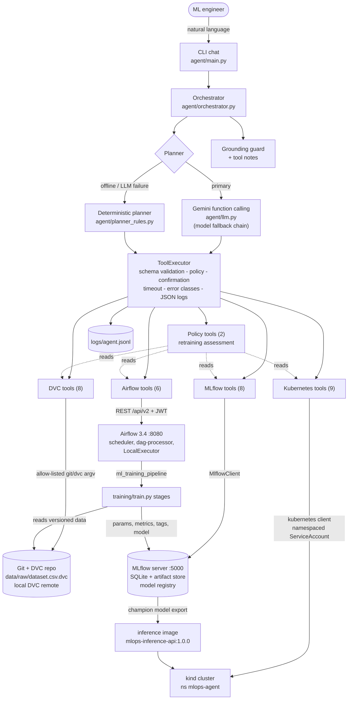
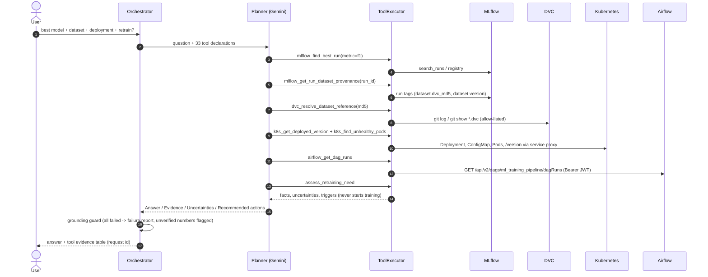
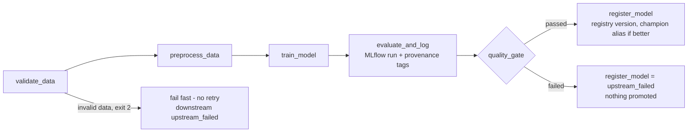
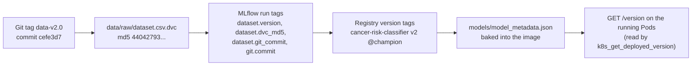

# Architecture - MLOps Copilot Agent

This document describes how the agent, its tools and the four MLOps systems fit together, why each
technology was chosen, and which safety controls apply to every request. Diagrams are Mermaid
(rendered by GitHub); PNG renders are in `docs/img/`.

## 1. Component view

| Layer | Responsibility | Key files |
|---|---|---|
| Interface | Chat / one-shot CLI, confirmation prompt, transcripts | `agent/main.py` |
| Orchestration | Request ids, planner selection, LLM fallback without repeating state changes, grounding guard | `agent/orchestrator.py` |
| Planning | Gemini function calling over JSON-schema tool declarations; deterministic rule planner | `agent/llm.py`, `agent/planner_rules.py` |
| Execution | Validation, authorization, confirmation, timeout, error classification, structured logging | `agent/tools/base.py`, `agent/logging_utils.py` |
| Tools | 33 tools across 5 modules with Pydantic inputs | `agent/tools/*.py`, `agent/schemas.py` |
| Data | DVC-versioned dataset (tags `data-v1.0`, `data-v2.0`), `dvc.yaml` pipeline, local remote | `data/`, `dvc.yaml`, `dvc.lock` |
| Experiments | MLflow tracking server, experiments, registry with `champion` alias | `training/train.py` |
| Orchestration of training | Airflow 3 DAG with retries, fail-fast and quality gate | `dags/training_pipeline.py` |
| Serving | FastAPI image on Kubernetes (2 replicas, probes, limits, ConfigMap, RBAC) | `api/`, `Dockerfile`, `kubernetes/` |

## 2. Request lifecycle (mandatory integration scenario)

## 3. Training pipeline (Airflow DAG `ml_training_pipeline`)

* **Retries**: every task `retries=2`, `retry_delay=15s`, exponential back-off, `execution_timeout=15m`.
* **Fail-fast**: stages exit with code `2` for deterministic failures (bad data, failed gate); the DAG maps
  that to `AirflowFailException`, so retries are only spent on transient failures.
* **Quality gate**: F1 >= 0.93, recall >= 0.90, train/test F1 gap <= 0.06, and the training data must match
  a DVC-tracked version. `register_model` uses `all_success`, so a failed validation or gate prevents promotion.
* The same stage commands back `dvc repro` (`dvc.yaml`), so the pipeline is reproducible without Airflow.

## 4. Provenance chain

Every link is recorded data, so the agent can walk it in both directions and verify each hop
(`dvc_resolve_dataset_reference` confirms an MLflow-recorded md5 against Git history).

## 5. Safety model

| Control | Where | Effect |
|---|---|---|
| Strict input schemas (`extra="forbid"`, ranges) | `agent/schemas.py` | Invalid or unexpected arguments -> `invalid_request`, tool never runs |
| Approved namespaces (reads and writes) | `KubernetesTools._ns`, `_authorize_mutation` | Other namespaces -> `denied` before any API call |
| Managed deployment only | `_authorize_mutation` | Only `inference-api` can be restarted/scaled (0-5 replicas) |
| Approved DAGs + conf allow-list | `AirflowTools.authorize_trigger` | Unknown DAG, conf keys or model types -> `denied` |
| Explicit confirmation | `ToolExecutor` + CLI prompt / `--yes` | Every state-changing tool; a broken prompt counts as "no" |
| Command allow-list | `CommandRunner` | Only read-only `git`/`dvc` sub-commands, `shell=False`, validated revisions/paths |
| Cluster RBAC | `kubernetes/rbac.yaml` | Namespaced Role, no delete/create, `patch` only on `inference-api` |
| Timeouts | executor + HTTP/K8s/subprocess clients | Hung services -> `timeout`, never block the agent |
| Grounding guard | `MLOpsAgent._ground` | All tools failed -> factual failure report; unverified numbers flagged |
| No repeated side effects | LLM fallback path | A state change already executed is summarised, never re-run |
| Secret hygiene | `.env` (git-ignored), redaction filter | Keys/passwords/tokens replaced by `***REDACTED***` in logs |

## 6. Technology choices

| Need | Choice | Why |
|---|---|---|
| Dataset versioning | DVC 3 + Git tags + local remote | Content hashes give exact provenance; `dvc get --rev` reproduces any version without touching the workspace |
| Experiment tracking | MLflow 3 server, SQLite backend | `MlflowClient` gives structured search, registry and aliases; SQLite is enough for one machine |
| Orchestration | Apache Airflow 3.4 (standalone, LocalExecutor) | Required Airflow 3 REST API v2 with JWT auth; separate virtualenv avoids dependency conflicts |
| Serving | FastAPI + uvicorn | Typed request validation, simple health endpoints for probes |
| Cluster | kind | Real Kubernetes API locally (RBAC, probes, EndpointSlices, service proxy) at low cost |
| LLM | Gemini (google-genai) with fallback models | Native function calling with JSON schemas; free tier; model fallback on quota |
| Agent framework | Own loop (no LangChain) | Every call passes through one auditable executor; fewer dependencies; easy to test |
