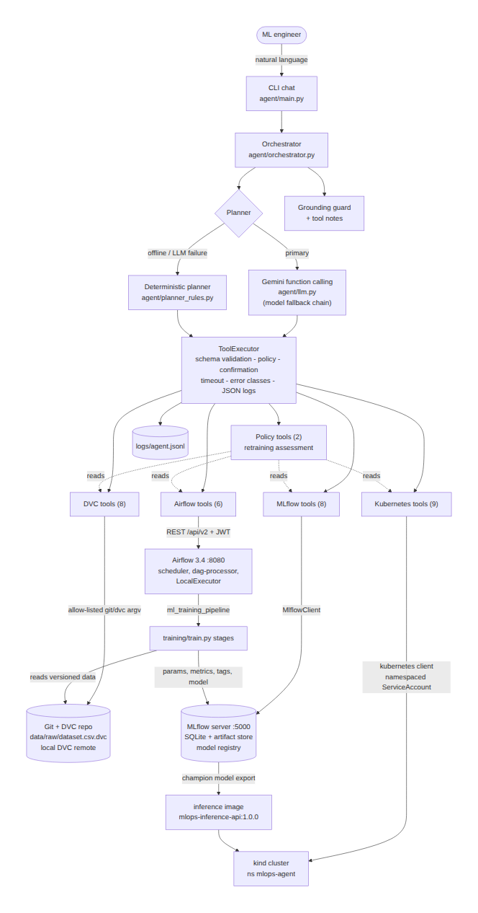
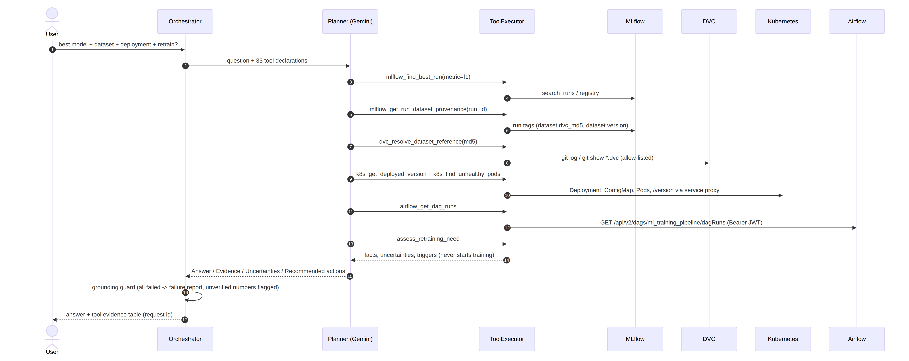
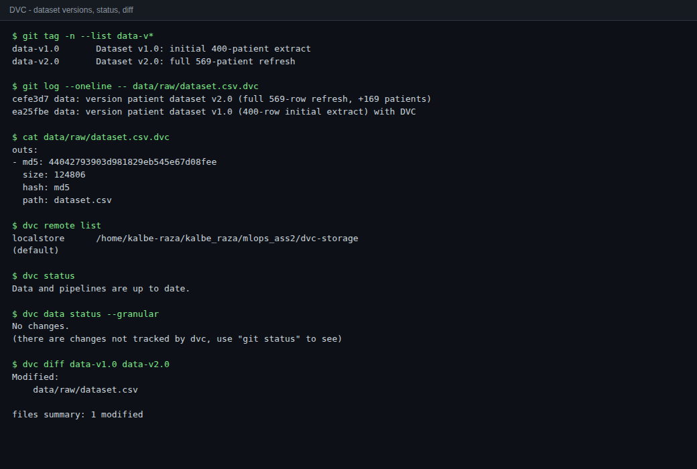
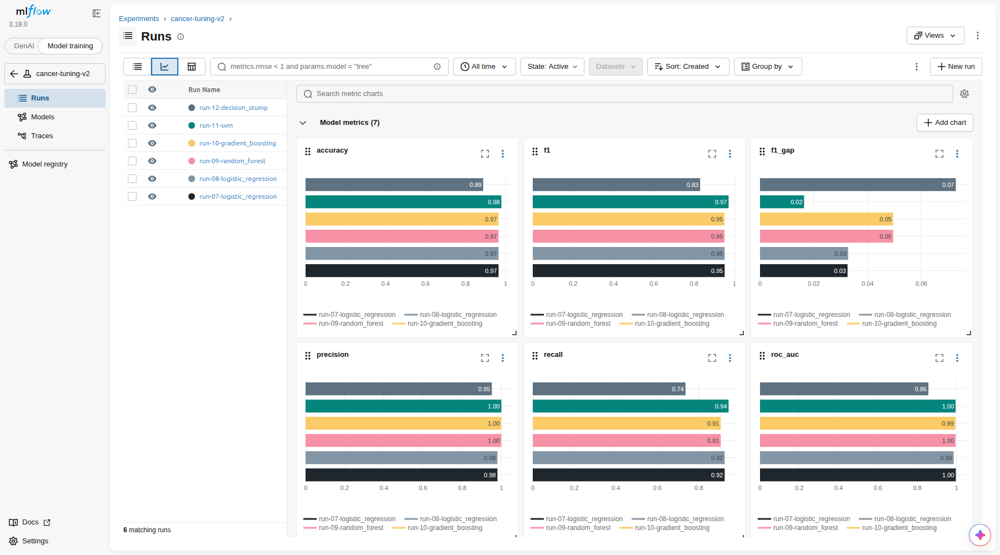
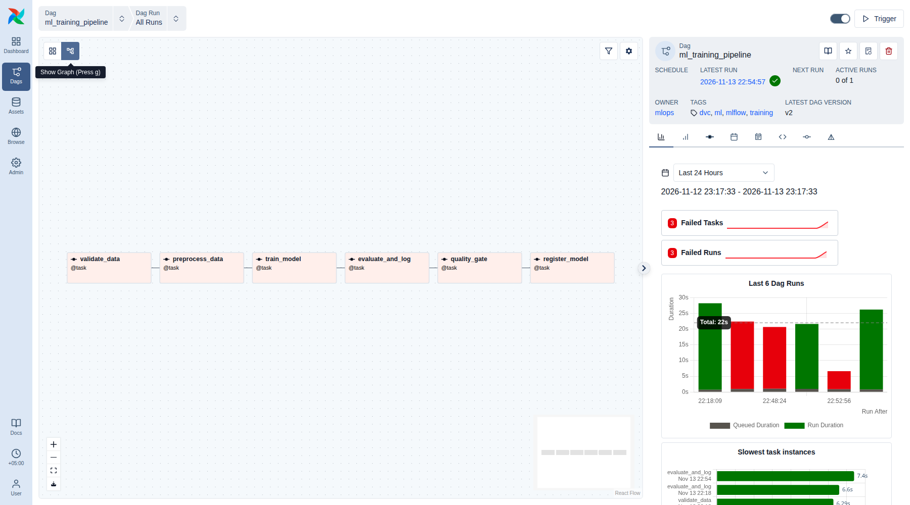
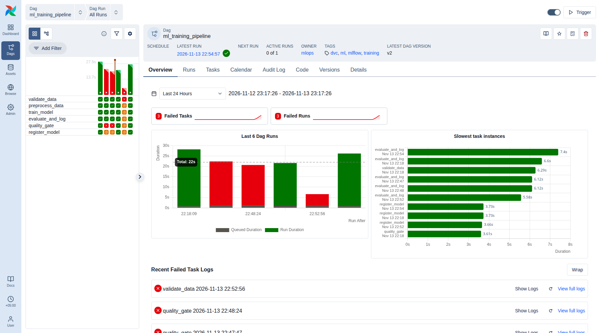
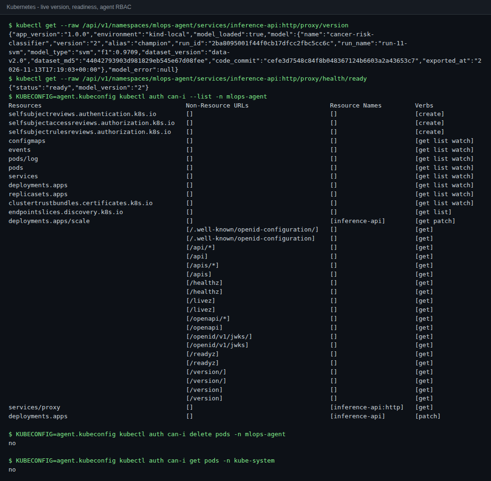
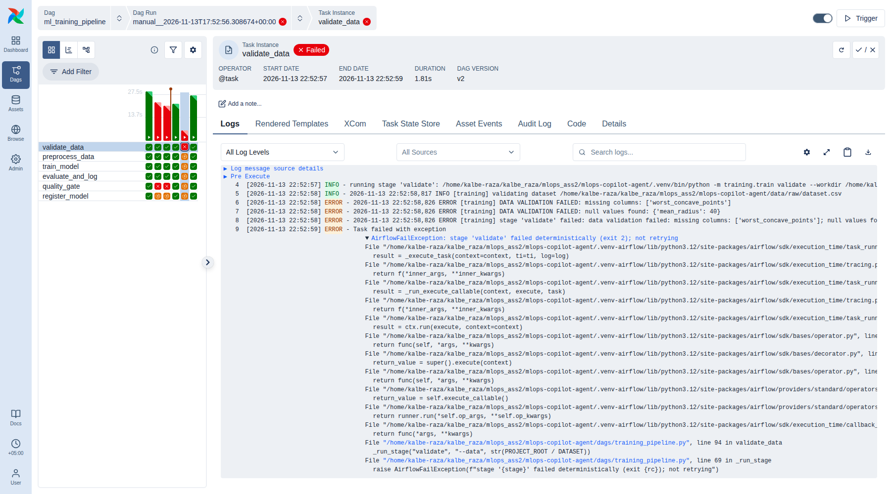

# Building a Production-Ready MLOps AI Agent - Technical Report

| | |
|---|---|
| **Course** | MLOps & Production AI Engineering - Assignment 03 (Fall 2026) |
| **Student** | Syed Kalbe Raza - 22i-0794 - Section B |
| **Instructor** | Hammad Majeed |
| **Repository** | <https://github.com/kalbe-raza/mlops-copilot-agent> |
| **Stack** | Python 3.12 - DVC 3.67 - MLflow 3.18 - Apache Airflow 3.4.0 - Kubernetes 1.37 (kind) - FastAPI - Gemini function calling - GitHub Actions |

## 1. Summary

MLOps Copilot is a conversational agent that does the routine work of an ML engineer: finding the dataset
version behind a model, comparing experiments, running the training pipeline, checking the deployment and
investigating failures. It uses **33 structured tools** on four real systems. These are a DVC-versioned dataset
(two tagged versions), an MLflow server (18 runs in 4 experiments, a registry with a `champion` alias), an
Airflow 3 training DAG with a quality gate, and a FastAPI inference service on Kubernetes.

Four design rules apply throughout:

1. **Evidence only.** Every operational statement comes from a tool result. If every call fails, a guard
   replaces the answer with a factual failure report, and decimal numbers that match no tool output are flagged.
2. **One safe executor.** Validation, policy checks, confirmation, timeouts, error classification and
   structured logs are enforced for all tools in one place.
3. **Least privilege.** Mutations need explicit confirmation and are limited to the `mlops-agent` namespace,
   the `inference-api` Deployment and the `ml_training_pipeline` DAG. A namespaced RBAC Role enforces the
   same limits in the cluster.
4. **Graceful degradation.** Gemini plans by default, with a chain of fallback models. A deterministic planner
   answers when the LLM is unavailable and never repeats a state change the LLM already made.

The system was exercised end to end: 5 recorded conversations, 2 injected failures that were diagnosed and
resolved, and 79 automated tests that run in GitHub Actions on every pull request.

## 2. System architecture



| Component | Implementation | Runs as |
|---|---|---|
| Conversational interface | `agent/main.py` (rich CLI, one-shot or chat, transcripts, JSON output) | local process |
| Orchestrator | `agent/orchestrator.py`: request ids, planner selection, fallback, grounding guard, tool notes | in-process |
| Planners | `agent/llm.py` (Gemini, manual function-calling loop, model fallback); `agent/planner_rules.py` (deterministic) | in-process |
| Executor + tools | `agent/tools/base.py`, `dvc_tools.py`, `mlflow_tools.py`, `airflow_tools.py`, `kubernetes_tools.py`, `policy_tools.py` | in-process |
| Dataset versioning | DVC 3.67, tags `data-v1.0`/`data-v2.0`, `dvc.yaml` pipeline, local remote | Git repo |
| Experiment tracking | MLflow 3.18 server, SQLite backend, proxied artifact store, model registry | `:5000` |
| Workflow orchestration | Airflow 3.4.0 standalone (api-server, scheduler, dag-processor, triggerer, LocalExecutor), separate venv | `:8080` |
| Model serving | FastAPI image `mlops-inference-api:1.0.0` on kind, namespace `mlops-agent` | Kubernetes |

**Request lifecycle.** The user's question goes to the planner along with JSON-schema declarations of all 33
tools. Each function call the model emits is executed by the `ToolExecutor`. Results return to the model as
function responses in a compact `{status, data | error, note}` form; a failed tool explicitly says
"No data was retrieved. Do not invent values". When the model answers, the orchestrator applies the
grounding guard, appends deterministic tool notes (for example "candidate for review, not an automatic
production promotion"), and returns the answer with a table of every tool call.



### 2.1 Why these technologies

| Decision | Reason |
|---|---|
| Own tool-calling loop instead of LangChain | Every call passes through one auditable executor; automatic function calling is disabled; fewer dependencies; easy to unit-test with fake LLM clients |
| Gemini (`google-genai`, API `v1beta`) | Native function calling with JSON schemas and a free tier. The free tier has 20 requests/day/model, so a fallback chain (`gemini-2.5-flash` -> `gemini-3-flash-preview` -> `gemini-3.5-flash-lite` -> `gemini-3.1-flash-lite`) was added |
| Deterministic planner | CI and offline demos need no key; it is also the fallback when the LLM fails |
| Airflow in its own virtualenv | Airflow's pinned constraints conflict with MLflow's; tasks call the project interpreter, so the stacks never mix |
| kind | A real API server (RBAC, probes, EndpointSlices, service proxy) at laptop cost |
| SQLite MLflow backend, local DVC remote | Enough for one machine; see limitations for the production path |

## 3. Module implementation

### 3.1 DVC data management (Task 1)

* **Data.** Wisconsin Diagnostic Breast Cancer data (bundled with scikit-learn, no network needed) with
  malignancy as the positive class. `scripts/make_dataset.py` is deterministic.
    * **v1.0** (`ea25fbe`, tag `data-v1.0`): 400-patient stratified extract, md5 `c0437af7...`.
    * **v2.0** (`cefe3d7`, tag `data-v2.0`): full 569-patient refresh, md5 `44042793...`.
* **Remote and pipeline.** Both versions are pushed to the DVC remote `localstore`. `dvc.yaml` defines
  `validate -> preprocess -> train -> evaluate`, with parameters in `params.yaml` and metrics in
  `pipeline_outputs/metrics.json`; `dvc.lock` is committed.
* **Provenance capture** (`training/provenance.py`). Each training run records these MLflow tags:
  `dataset.path`, `dataset.dvc_md5`, `dataset.actual_md5`, `dataset.matches_dvc`, `dataset.git_commit`
  (last commit of the `.dvc` file), `dataset.version` (data tag; suffixed `+uncommitted` or `+untagged`
  when applicable), `dataset.rows`, `git.commit` and `git.remote` (credentials stripped).
* **Tools (8).** `dvc_list_tracked_datasets`, `dvc_get_dataset_version`, `dvc_list_dataset_versions`,
  `dvc_compare_dataset_versions` (hash, row delta, schema change, `dvc diff`), `dvc_check_data_changes`
  (`dvc status`), `dvc_resolve_dataset_reference` (MLflow md5 or commit -> version), `dvc_explain_reproduction`,
  and `dvc_reproduce_dataset_version` (`dvc get --rev` into `artifacts/reproduced/`, md5-verified).
* **Restriction.** `CommandRunner` only runs allow-listed read-only sub-commands (`dvc status|diff|data status|get|remote list|list`,
  `git log|show|tag|describe|rev-list|status|ls-files|rev-parse`) with `shell=False`. Revisions and paths
  are validated against option injection and path traversal.
* **Reproducible checkout demonstrated.** `dvc get . data/raw/dataset.csv --rev data-v1.0` produced md5
  `c0437af750ce5e7418d94a4689cebac6` (401 lines = header + 400 rows), identical to the `.dvc` file at
  that tag (`evidence/dvc.txt`). CI also regenerates v2.0 and checks it against the committed md5.



### 3.2 MLflow experiment intelligence (Task 2)

* **Experiments.** `cancer-baseline-v1` (6 runs on data-v1.0), `cancer-tuning-v2` (6 runs on data-v2.0),
  `cancer-airflow-pipeline` (5 DAG runs) and `cancer-dvc-pipeline` (`dvc repro`).
* **Logged per run.** Params, metrics (accuracy, precision, recall, F1, ROC-AUC, train F1, train/test F1 gap),
  the provenance tags above, a confusion matrix, the validation report, an MLflow sklearn model
  (skops-serialised) and a serving `model.joblib`.
* **Registry.** `cancer-risk-classifier` has v1-v5. `champion` = **v2** (`run-11-svm`, F1 0.9709) and
  `latest-passed` = v5. Each version carries the tags `dataset.version`, `dataset.dvc_md5`,
  `dataset.git_commit`, `f1`, `quality_gate` and `source_run_id`.
* **Tools (8).** `mlflow_list_experiments`, `mlflow_list_runs`, `mlflow_get_run_details`,
  `mlflow_find_best_run`, `mlflow_compare_runs`, `mlflow_compare_experiments`, `mlflow_get_model_registry`
  and `mlflow_get_run_dataset_provenance`. All use `MlflowClient`, never the UI.
* **Run references.** Runs resolve by id, exact name, or number ("run 11" -> `run-11-*`).
* **Not production-ready by default.** `mlflow_find_best_run` returns the best run *and* the best run that
  passed the gate, plus caveats (failed gate, F1 gap > 0.05, not registered). `mlflow_compare_runs` only
  recommends among gate-passing runs, breaks ties by recall and then by smaller gap, and labels the result
  "a candidate for review".

| Run (data-v2.0) | Model | F1 | Recall | Gap | Gate |
|---|---|---|---|---|---|
| run-07 | logistic regression C=1 | 0.9515 | 0.9245 | 0.0326 | passed |
| run-09 | random forest 300/8 | 0.9505 | 0.9057 | 0.0495 | passed |
| run-10 | gradient boosting | 0.9505 | 0.9057 | 0.0495 | passed |
| **run-11** | **SVM C=3** | **0.9709** | **0.9434** | **0.0164** | **passed -> champion v2** |
| run-12 | decision stump | 0.8298 | 0.7358 | 0.0728 | failed |



### 3.3 Airflow workflow (Task 3)

* **DAG.** `ml_training_pipeline`: `validate_data -> preprocess_data -> train_model -> evaluate_and_log ->
  quality_gate -> register_model`, triggered manually only, `max_active_runs=1`. Typed params are
  `model_type` (enum), `params` (overrides of the per-model defaults), `experiment` and `run_name`.
* **Task execution.** Each task runs `python -m training.train <stage>` in the project venv and streams the
  output into the Airflow task log (ERROR lines at error level).
* **Retries and fail-fast.** `retries=2`, 15 s exponential back-off, 15-minute timeout. Exit code 2 (invalid
  data, failed gate) raises `AirflowFailException`, so deterministic failures are not retried; other
  non-zero exits are retried.
* **Quality gate.** F1 >= 0.93, recall >= 0.90, F1 gap <= 0.06, and the data must match DVC. It writes
  `quality_gate.status/reasons` to the MLflow run. `register_model` (`all_success`) registers the version
  and moves `champion` only if F1 >= the current champion's.
* **REST client.** `AirflowClient` authenticates with `POST /auth/token` as the restricted `agent` user
  (role `user`), sends `Authorization: Bearer <JWT>`, and refreshes the token once on 401. Connection
  errors and 5xx responses map to `unavailable`.
* **Tools (6).** `airflow_list_dags`, `airflow_get_dag_runs`, `airflow_get_task_instances`,
  `airflow_get_failed_tasks` (root-cause task, log error lines, skipped downstream tasks),
  `airflow_get_task_logs`, and `airflow_trigger_dag`. The trigger tool is approved-DAG-only, allows only
  the conf keys `model_type|params|experiment|run_name` and allow-listed model types, requires
  confirmation, unpauses the DAG if needed, sends `logical_date: null`, and can wait and report task states.




### 3.4 Kubernetes deployment and operations (Task 4)

* **Image.** `Dockerfile`: python:3.12-slim, pinned runtime dependencies identical to training, non-root
  UID 10001. It carries the champion model exported from the registry (`scripts/export_model.py`) and
  `model_metadata.json` (registry version, run, dataset version, md5, code commit).
* **API.** `/health/live` (process only), `/health/ready` (503 until a model is loaded), `/predict`
  (validated 30-feature instances), `/version` and `/metadata`, with JSON request logs.
* **Manifests** (`kubernetes/`). Namespace; Deployment with **2 replicas**, rolling update
  `maxUnavailable: 0`, **readiness and liveness probes**, **requests 100m/192Mi and limits 500m/384Mi**,
  read-only root filesystem, dropped capabilities and `envFrom` the **ConfigMap**
  (`APP_VERSION, APP_ENV, LOG_LEVEL, PREDICTION_THRESHOLD, MODEL_PATH, MODEL_METADATA_PATH`); a
  **ClusterIP Service** (port 80 -> `http`).
* **RBAC.** `rbac.yaml` defines ServiceAccount `mlops-agent`, a namespaced Role (read pods, logs, services,
  events, configmaps, endpointslices, deployments; `get` on `services/proxy` for `inference-api:http`;
  `patch` only on `deployments/inference-api` and its scale) and a RoleBinding.
  `scripts/make_agent_kubeconfig.sh` issues a time-limited token kubeconfig for the agent. Verified:
  `can-i delete pods` = no, `can-i get pods -n kube-system` = no.
* **Tools (9).** `k8s_list_deployments`, `k8s_list_pods`, `k8s_get_pod_logs` (including the previous
  container), `k8s_list_services` (ready/not-ready endpoints from EndpointSlices), `k8s_find_unhealthy_pods`
  (not ready, waiting reasons, last termination, restarts, per-pod warning events), `k8s_get_events`, and
  `k8s_get_deployed_version` (image tag, version label, ConfigMap, live `/version` through the API-server
  service proxy, so no port-forward is needed). The mutating tools are `k8s_restart_deployment` and
  `k8s_scale_deployment` (0-5 replicas).



### 3.5 Multi-tool agent (Integration)

**`assess_retraining_need`** correlates the champion's age, F1 and gate (MLflow registry), the current
DVC version against the champion's training md5, user-supplied production F1, recent Airflow runs, and the
model the cluster actually serves. It recommends retraining **only** when an explicit trigger fires:

* freshness > 30 days;
* the champion's gate failed;
* the champion's F1 is below 0.93;
* a newer dataset version exists;
* supplied degradation results fall below the floor.

It returns `decision`, `facts`, `uncertainties` and `triggers`. If the champion's metrics or the data
version cannot be verified, it returns `insufficient_evidence`, never "no retraining needed". It never
starts training.

Mandatory scenario mapping (Conversation 5):

| Required step | Implementation (tool) | Observed result |
|---|---|---|
| 9. MLflow: recent experiments and metrics | `mlflow_find_best_run` | best gate-passing run `run-11-svm`, F1 0.9709 |
| 10. DVC reference of the selected run | `mlflow_get_run_dataset_provenance`; the recorded md5 is checked against DVC inside `assess_retraining_need` (the rule planner also calls `dvc_resolve_dataset_reference`) | data-v2.0, md5 `44042793...`, commit `cefe3d7` |
| 11. Kubernetes deployment and health | `k8s_get_deployed_version`, `k8s_find_unhealthy_pods` | image 1.0.0, 2/2 ready, serving registry v2 (same run) |
| 12. Airflow recent workflows | `airflow_get_dag_runs` | latest `ml_training_pipeline` run succeeded |
| 13. Correlate | `assess_retraining_need` | champion trained on the current data version, fresh, gate passed |
| 14. Facts, uncertainties, actions | answer sections | "Retraining is not recommended"; uncertainty: no production degradation results; no automatic retraining |

## 4. Tool definitions and permissions

All inputs are Pydantic models with `extra="forbid"` and bounded values; their JSON schemas are given to the
LLM. Every tool returns a `ToolResult {call_id, request_id, tool, status, duration_ms, data, error}`, where
`status` is one of `success | error | unavailable | timeout | invalid_request | denied`.

| Module | Tool | State-changing | Guard |
|---|---|---|---|
| dvc | `dvc_list_tracked_datasets`, `dvc_get_dataset_version`, `dvc_list_dataset_versions`, `dvc_compare_dataset_versions`, `dvc_check_data_changes`, `dvc_resolve_dataset_reference`, `dvc_explain_reproduction` | no | command allow-list, revision and path validation |
| dvc | `dvc_reproduce_dataset_version` | writes only `artifacts/reproduced/` | as above, hash-verified |
| mlflow | `mlflow_list_experiments`, `mlflow_list_runs`, `mlflow_get_run_details`, `mlflow_find_best_run`, `mlflow_compare_runs`, `mlflow_compare_experiments`, `mlflow_get_model_registry`, `mlflow_get_run_dataset_provenance` | no | read-only client, health probe, no retries when down |
| airflow | `airflow_list_dags`, `airflow_get_dag_runs`, `airflow_get_task_instances`, `airflow_get_failed_tasks`, `airflow_get_task_logs` | no | JWT as the restricted `agent` user |
| airflow | `airflow_trigger_dag` | **yes** | approved DAG list, conf-key and model-type allow-list, **user confirmation** |
| kubernetes | `k8s_list_deployments`, `k8s_list_pods`, `k8s_get_pod_logs`, `k8s_list_services`, `k8s_find_unhealthy_pods`, `k8s_get_events`, `k8s_get_deployed_version` | no | approved namespaces only, RBAC Role |
| kubernetes | `k8s_restart_deployment`, `k8s_scale_deployment` (0-5) | **yes** | approved namespace, managed Deployment only, **user confirmation**, RBAC `patch` on `inference-api` only |
| policy | `get_retraining_policy`, `assess_retraining_need` | no | assessment only, never triggers training |

## 5. Reliability, safety and observability

* **Order of checks.** Schema validation -> policy (`authorize`) -> confirmation -> execution with a timeout.
  A request that breaks policy is rejected *before* the user is asked. A broken or absent prompt counts as "no".
* **Error classification.** Connection failures and 5xx -> `unavailable`; `ToolError` -> `error`;
  RBAC 401/403 -> `denied`; the timer -> `timeout`; anything unexpected -> `error`. The agent never crashes
  on a tool failure.
* **Grounding guard.**
    * If every call failed, the answer becomes "I could not retrieve any operational data ... No values have
    been assumed or estimated", followed by each failure and its remedy.
    * Otherwise, decimal values in the answer that appear in no tool output or in the user's question are
    listed as unverified.
* **No repeated side effects.** If the LLM fails after a state-changing call succeeded, the fallback reports
  the completed calls instead of re-planning (see §8.3).
* **Secrets.** Secrets live only in `.env`. Logs redact keys matching `password|secret|token|api_key|
  authorization|credential|cookie`, bearer tokens, Google API keys and every registered secret value.
  A scan of all commits and logs found neither the Gemini key nor the Airflow password.
* **Structured logs** (`logs/agent.jsonl`). There is one `tool_call` line per call (request id, call id, tool,
  module, status, duration, mutating flag, redacted arguments, error) plus `request_received`,
  `llm_fallback` and `request_completed` lines, for example:

```json
{"ts": "2026-11-13T17:58:05.969+00:00", "level": "WARNING", "logger": "mlops_agent", "event": "tool_call",
 "request_id": "f508b3b1e0d1", "call_id": "de94b66712", "tool": "k8s_restart_deployment",
 "module": "kubernetes", "status": "denied", "duration_ms": 2.28, "mutating": true, "arguments": {},
 "error": "'k8s_restart_deployment' changes system state and requires explicit user confirmation; ..."}
```

## 6. Testing and CI

There are 79 tests: 76 unit tests run with `pytest`, plus 3 DAG-integrity tests that run in the Airflow
environment. They pass locally, in a fresh clone and in GitHub Actions.

| Requirement | Tests (file::name) |
|---|---|
| >= 8 meaningful tests | 79 tests in 9 files |
| Mocked tool responses for unavailable services | `UnavailableModule` fixture; `test_unreachable_*` for MLflow, Airflow and Kubernetes |
| Successful tool selection and execution | `test_rule_planner_selects_the_right_tools` (12 intents), `test_mandatory_scenario_correlates_all_four_technologies_without_retraining`, `test_gemini_planner_executes_tool_calls_through_the_executor` |
| Timeouts, invalid requests, service failures | `test_tool_timeout_is_reported_not_raised`, `test_invalid_arguments_are_rejected_before_the_tool_runs`, `test_unknown_tool_is_rejected_as_invalid_request`, `test_service_failures_are_classified` |
| Agent does not invent results | `test_agent_does_not_invent_results_when_tools_are_unavailable`, `test_llm_answer_is_replaced_when_every_tool_failed`, `test_partial_outage_never_concludes_no_retraining`, `test_unverified_numbers_in_llm_answer_are_flagged` |
| Unauthorized Kubernetes modifications rejected | `test_restart_in_unapproved_namespace_is_rejected_without_api_call`, `test_restart_without_user_confirmation_is_rejected`, `test_scale_of_unmanaged_deployment_is_rejected`, `test_read_tools_are_scoped_to_approved_namespaces`, `test_agent_rbac_is_namespace_scoped_and_least_privilege` |
| Structured logs without secrets | `test_successful_call_returns_data_and_logs_structured_record`, `test_structured_logs_never_contain_secrets` |
| Pipeline safety | `test_validation_rejects_corrupted_dataset`, `test_quality_gate_blocks_weak_model_and_promotion`, `test_stages_are_chained_in_order`, `test_retry_policy_and_promotion_guard` |

The CI workflow (`.github/workflows/ci.yml`) triggers on `pull_request` and on pushes to `main`, and has
three jobs:

1. **Lint and tests:** `uv sync --frozen`, `ruff check`, a check that the dataset regenerates to the
   committed DVC md5, then `pytest --cov`.
2. **DAG validation:** Airflow 3.4.0 with its official constraints, `airflow db migrate`, then the DAG tests.
3. **Image build:** trains on the versioned data with a local MLflow store, exports the champion, builds
   the image and smoke-tests `/health/ready` and `/version`.

External services are mocked; MLflow and DVC use temporary local instances.

## 7. Evidence from DVC, MLflow, Airflow and Kubernetes

| Technology | Screenshots (`screenshots/`) | Exported evidence (`evidence/`) |
|---|---|---|
| DVC | `dvc-01-versions-status-diff.png`, `dvc-02-pipeline-metrics-reproduce.png` | `dvc.txt` (tags, `.dvc`, remote, status, diff, dag, metrics, `dvc get` reproduction) |
| MLflow | `mlflow-01..07` (experiments, runs, metric charts, comparison, run 11 provenance tags, registry) | `mlflow.txt` (all runs, metrics, gates, registry versions and aliases) |
| Airflow | `airflow-01..07` (DAGs, grid with failed and successful runs, graph, failed `validate_data` and `quality_gate` logs, successful run) | `airflow.txt` (REST API: runs and task states of all 6 DAG runs) |
| Kubernetes | `k8s-01-resources.png`, `k8s-02-version-health-rbac.png` | `kubernetes.txt` (pods, rs, svc, endpointslices, describe, ConfigMap, events, logs, live `/version`, RBAC `can-i`) |
| Agent | `agent-01..03` (terminal renders) | `conversations.md`, `failure-*.md`, `agent-structured-logs.jsonl` |



## 8. Tested agent conversations

Full transcripts with raw tool outputs are in `evidence/conversations.md`. All five ran against the live
stack.

| # | Scenario | Planner | Tools called | Outcome |
|---|---|---|---|---|
| 1 | Dataset provenance: "Which dataset version was used to train run 11, and how can I reproduce exactly that dataset?" | gemini-2.5-flash | `mlflow_get_run_dataset_provenance`, `dvc_resolve_dataset_reference`, `dvc_explain_reproduction` | data-v2.0, md5 `44042793...`, commit `cefe3d7`, plus a non-destructive `dvc get --rev` command |
| 2 | Model selection: "Compare the last five training runs and recommend the best candidate based on F1 score." | gemini-2.5-flash | `mlflow_compare_runs` | all 5 runs listed; `run-11-svm` recommended (F1 0.9709, recall 0.9434, gap 0.0164); `run-12-decision_stump` excluded (failed gate); "candidate for review" note |
| 3 | Pipeline execution: "Trigger the model training pipeline with a gradient boosting model and report whether execution succeeded." | gemini-3-flash-preview (fallback after quota) | `airflow_list_dags`, `airflow_trigger_dag` (confirmed) | run `manual__2026-11-13T17:52:13` **succeeded**, 6/6 tasks, model registered as v4 |
| 4 | Deployment diagnosis: "Why is my prediction API unavailable?" (during failure 2) | gemini-3-flash-preview | `k8s_find_unhealthy_pods`, `k8s_list_services`, `k8s_list_deployments`, `k8s_get_events`, `k8s_get_pod_logs` | 0/2 ready, 0 endpoints, readiness 503, `FileNotFoundError: /app/models/model_v2.joblib` |
| 5 | Multi-tool: the mandatory integration scenario | gemini-2.5-flash | `mlflow_find_best_run`, `k8s_get_deployed_version`, `k8s_find_unhealthy_pods`, `airflow_get_dag_runs`, `mlflow_get_run_dataset_provenance`, `assess_retraining_need` | facts, uncertainties and actions as in §3.5; retraining **not** recommended and nothing triggered |

Dataset provenance, deployment diagnosis (after recovery: "no fault found") and the mandatory scenario were also run with the deterministic planner (`screenshots/agent-01..03`).

## 9. Failure investigations

### 9.1 Injected failure 1: corrupted training data (data/workflow layer)

* **Injection.** The tracked dataset was overwritten with a version missing `worst_concave_points` and
  containing 40 nulls in `mean_radius` (`make inject-data-failure`).
* **Symptom.** Triggered run `manual__2026-11-13T17:52:56` **failed**. `validate_data` failed on try 1 with
  no retries (deterministic failure), and all 5 downstream tasks were `upstream_failed`. No MLflow run was
  logged and nothing was promoted.
* **Diagnosis.** `airflow_get_failed_tasks` named the root-cause task and quoted the log lines
  `DATA VALIDATION FAILED: missing columns: ['worst_concave_points']` and `null values found: {'mean_radius': 40}`.
  `dvc_check_data_changes` showed `data/raw/dataset.csv` **modified** against its `.dvc` record.
* **Root cause.** An uncommitted, invalid data change.
* **Resolution.** `dvc checkout --force data/raw/dataset.csv` restored data-v2.0. The agent confirmed DVC
  was clean, then re-triggered: run `manual__2026-11-13T17:54:57` **succeeded**.
* Details: `evidence/failure-1-data-validation.md`.

### 9.2 Injected failure 2: broken model path in the ConfigMap (infrastructure layer)

* **Injection.** `MODEL_PATH` was patched to `/app/models/model_v2.joblib` and the pods were recreated,
  simulating a node drain (`make inject-k8s-failure`).
* **Symptom.** Both pods `Running 0/1`, 0 restarts (liveness healthy), Service with 0 endpoints: the API was
  unavailable.
* **Diagnosis.** Pods were not ready, warning events showed `Readiness probe failed ... statuscode: 503`,
  and the logs contained `FileNotFoundError: Model file not found: /app/models/model_v2.joblib`. The
  follow-up `k8s_get_deployed_version` showed the ConfigMap value.
* **Root cause.** A wrong model path in the ConfigMap.
* **Resolution.** The Git version of `configmap.yaml` was re-applied, then the restart went through the
  agent:
    * restarting `coredns` in `kube-system` was **denied by policy**, with no prompt shown;
    * a restart without confirmation was **denied**;
    * the confirmed restart rolled out new pods: 2/2 ready, 2 endpoints, `/health/ready` = ready.
* Details: `evidence/failure-2-k8s-config.md`.

### 9.3 Unexpected failures found and fixed during development

| # | Observation | Diagnosis | Fix |
|---|---|---|---|
| 1 | **Duplicate DAG trigger.** One request produced two runs, `17:47:47` and `17:48:24` (`evidence/quality-gate-block.md`) | Gemini triggered the DAG, its next call hit HTTP 429 (daily quota), and the fallback re-planned from scratch | `LLMError.partial_results`; the fallback summarises instead of repeating state changes (regression test added) |
| 2 | Gradient-boosting runs failed the quality gate | DAG default `params` were random-forest-specific, so GB got `max_depth=8` and overfit (gap 0.0784). The gate correctly blocked promotion | Per-model `DEFAULT_PARAMS`; DAG default `params={}`; re-run passed |
| 3 | During a total outage the policy said "no retraining needed" | Missing evidence was being treated as "no trigger"; found by `test_agent_does_not_invent_results_when_tools_are_unavailable` | `insufficient_evidence` decision; the tool fails if no source is reachable |
| 4 | `mlflow.sklearn.log_model` raised "untrusted types ... sklearn.tree._tree.Tree" | MLflow 3.18 serialises with skops, which needs tree node storage to be trusted explicitly | `skops_trusted_types=["sklearn.tree._tree.Tree"]` for our own models |
| 5 | Gemini returned 400 "Function calling is not enabled for api version v1" | The SDK defaulted to `v1` | `HttpOptions(api_version="v1beta")`; the rule fallback kept the agent answering meanwhile |
| 6 | The machine ran out of memory after starting MLflow | MLflow 3 server started ~9 GenAI job workers (~2 GB) | `MLFLOW_SERVER_ENABLE_JOB_EXECUTION=false`; Airflow `PARALLELISM=4` |
| 7 | Live `/version` JSON failed to parse | The Kubernetes client returned Python `repr` for proxied JSON | `_preload_content=False` and parse the raw bytes |
| 8 | Grounding check flagged `9.631695` as unverified | Run name `...-9.631695+00:00` was parsed as a negative number | Unsigned number matching (test added) |

## 10. Known limitations and proposed improvements

| Limitation | Improvement |
|---|---|
| Single-machine stack: kind, SQLite MLflow, Airflow standalone with LocalExecutor, local DVC remote | PostgreSQL backends, S3/GCS artifact and DVC storage, Airflow on Kubernetes (KubernetesExecutor or Helm chart), managed Kubernetes |
| The model is baked into the image; no continuous delivery from the registry | GitOps (Argo CD) or KServe/MLflow serving: promote when `champion` changes, with canary rollout |
| Model degradation relies on user-supplied production F1 | Prediction logging, delayed labels, drift monitoring (e.g. Evidently), with results exposed as a tool for the retraining policy |
| Free-tier LLM quotas (20 requests/day/model); LLM summaries can omit details (one answer listed 3 of 5 skipped tasks) | Paid quota or a self-hosted model; schema-constrained answers checked against tool data; an LLM evaluation set in CI |
| The grounding guard only checks decimal numbers | Entity-level verification (run ids, versions, task names) against tool outputs |
| Confirmation is a CLI prompt or `--yes`; the audit log is a local file | Approval workflow (chat ops or PR) with authenticated users; append-only audit store; per-user RBAC |
| The rule planner is keyword-based | Only a fallback; could be replaced by a small intent classifier |
| The MLflow server has no authentication locally | Enable MLflow auth / a reverse proxy with SSO |
| Thread-based timeouts cannot kill a stuck call (the clients have their own timeouts) | Run tools in subprocesses or as async calls with cancellation |

## 11. Reproducing the work

The README covers installation, environment configuration, launching every service (`make mlflow`,
`make airflow`, `make cluster image deploy kubeconfig`), seeding experiments, running the agent
(`make chat`), tests (`make test`, `make test-dag`) and the failure demos (`make inject-*-failure` /
`make resolve-*-failure`). Evidence can be regenerated with `scripts/export_evidence.sh`,
`scripts/capture_screenshots.py` and `scripts/render_diagrams.py`.
